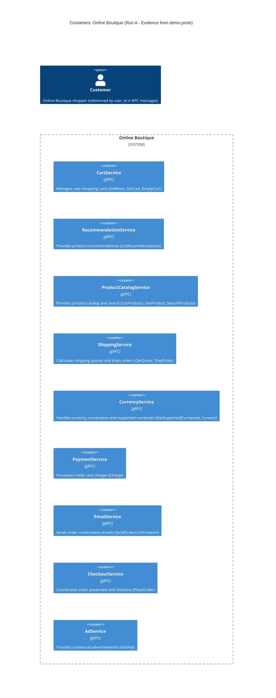

# Architecture Recovery: Run A

## Agent
Antigravity (Gemini 2.5 Pro)

## Files read
- `prompts/1-recover-architecture.md`
- `system/online-boutique/protos/demo.proto`

## Containers table

| Container name | Technology / Language | Responsibility | Evidence |
| :--- | :--- | :--- | :--- |
| `CartService` | gRPC / Protocol Buffers (`proto3`) *(implementation language: Not evidenced in the provided files)* | Manages user shopping carts: adding items (`AddItem`), retrieving cart contents (`GetCart`), and clearing cart items (`EmptyCart`). | `system/online-boutique/protos/demo.proto:23-27` |
| `RecommendationService` | gRPC / Protocol Buffers (`proto3`) *(implementation language: Not evidenced in the provided files)* | Generates product recommendations for a user given their ID and context product IDs (`ListRecommendations`). | `system/online-boutique/protos/demo.proto:56-58` |
| `ProductCatalogService` | gRPC / Protocol Buffers (`proto3`) *(implementation language: Not evidenced in the provided files)* | Manages the product catalog: listing all products (`ListProducts`), fetching details of a product by ID (`GetProduct`), and searching products by text query (`SearchProducts`). | `system/online-boutique/protos/demo.proto:71-75` |
| `ShippingService` | gRPC / Protocol Buffers (`proto3`) *(implementation language: Not evidenced in the provided files)* | Calculates shipping quotes based on destination address and items (`GetQuote`), and processes order shipping returning a tracking ID (`ShipOrder`). | `system/online-boutique/protos/demo.proto:107-110` |
| `CurrencyService` | gRPC / Protocol Buffers (`proto3`) *(implementation language: Not evidenced in the provided files)* | Lists supported currency codes (`GetSupportedCurrencies`) and converts an amount of money from one currency to another (`Convert`). | `system/online-boutique/protos/demo.proto:140-143` |
| `PaymentService` | gRPC / Protocol Buffers (`proto3`) *(implementation language: Not evidenced in the provided files)* | Processes payments by charging credit cards for a given monetary amount and returning a transaction ID (`Charge`). | `system/online-boutique/protos/demo.proto:177-179` |
| `EmailService` | gRPC / Protocol Buffers (`proto3`) *(implementation language: Not evidenced in the provided files)* | Sends order confirmation emails to customers containing order result details (`SendOrderConfirmation`). | `system/online-boutique/protos/demo.proto:199-201` |
| `CheckoutService` | gRPC / Protocol Buffers (`proto3`) *(implementation language: Not evidenced in the provided files)* | Handles the checkout workflow and order placement (`PlaceOrder`). | `system/online-boutique/protos/demo.proto:224-226` |
| `AdService` | gRPC / Protocol Buffers (`proto3`) *(implementation language: Not evidenced in the provided files)* | Serves context-based advertisements according to contextual keyword tags (`GetAds`). | `system/online-boutique/protos/demo.proto:243-245` |

## Dependencies table

| Caller | Callee | Protocol | Evidence |
| :--- | :--- | :--- | :--- |
| *None evidenced* | *None evidenced* | *None evidenced* | Not evidenced in the provided files |

> **Note on Dependencies:** `system/online-boutique/protos/demo.proto` defines service contracts, RPC signatures, and data models (message types). It defines only the callee service interfaces and contains no client invocation code, runtime bindings, or caller identity. Therefore, no runtime dependencies (caller → callee) are evidenced in this file.

## Mermaid diagram

## Gaps

1. **Runtime Call Graph / Service Dependencies (Caller → Callee):**
   - *Gap:* `demo.proto` declares service RPC methods (the callee interfaces) and request/response payloads, but does not declare callers or runtime invocation paths. For example, `CheckoutService.PlaceOrder` accepts credit card details and returns `OrderResult` (including shipping tracking IDs and costs), suggesting `CheckoutService` may coordinate calls to `PaymentService`, `ShippingService`, `CartService`, `CurrencyService`, and `EmailService` [Inferred]. However, this orchestration is not evidenced in `demo.proto`.
   - *Extra files to settle it:* Service implementation source code (e.g. `system/online-boutique/src/checkoutservice/`) or deployment configuration files (e.g. `system/online-boutique/kubernetes-manifests/` showing environment variables such as `*_SERVICE_ADDR`).

2. **Frontend / Web UI / Client Gateway:**
   - *Gap:* There is no `Frontend` container, reverse proxy, or API Gateway defined in `demo.proto`. How human users (`Person`) interact with the application (e.g., via HTTP/HTML web browser, REST, or mobile app) is not evidenced.
   - *Extra files to settle it:* Kubernetes manifests (`system/online-boutique/kubernetes-manifests/frontend.yaml`) or frontend application source code (`system/online-boutique/src/frontend/`).

3. **Data Stores and Persistence (Databases / Caches):**
   - *Gap:* No data stores (e.g., Redis, PostgreSQL, MySQL) or message brokers are declared in `demo.proto`. It is unknown how services such as `CartService` persist user cart state or how `ProductCatalogService` stores product catalog items.
   - *Extra files to settle it:* Kubernetes manifests (e.g. `redis.yaml` or stateful component descriptors in `system/online-boutique/kubernetes-manifests/`) or service source code configuration.

4. **Service Implementation Languages and Runtimes:**
   - *Gap:* Aside from `option go_package = "github.com/GoogleCloudPlatform/microservices-demo/hipstershop";` (which configures Go protobuf code generation), `demo.proto` does not evidence the actual implementation languages or runtime environments (e.g. Go, Python, Java, Node.js, C#, etc.) of the individual services.
   - *Extra files to settle it:* Build and dependency files in service source directories (e.g. `package.json`, `go.mod`, `pom.xml`, `requirements.txt`, or Dockerfiles under `system/online-boutique/src/`).

5. **External Third-Party Systems:**
   - *Gap:* `demo.proto` does not indicate whether services like `PaymentService`, `EmailService`, or `ShippingService` communicate with external third-party service providers (e.g., external credit card processing gateways, cloud email APIs, carrier shipping APIs) or perform internal simulated processing.
   - *Extra files to settle it:* Service source code or Kubernetes ConfigMaps / Secrets in `system/online-boutique/kubernetes-manifests/`.
