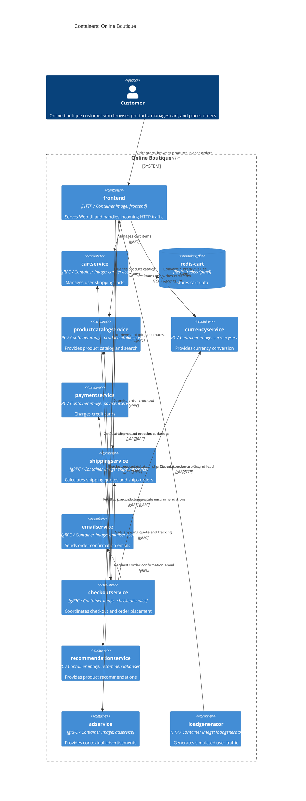

# Architecture Recovery: Online Boutique (Run B)

## 1. Agent
- **Product:** Antigravity
- **Model:** Gemini 2.5 Pro

## 2. Files read
- `prompts/1-recover-architecture.md`
- `system/online-boutique/protos/demo.proto`
- `system/online-boutique/kubernetes-manifests/adservice.yaml`
- `system/online-boutique/kubernetes-manifests/cartservice.yaml`
- `system/online-boutique/kubernetes-manifests/checkoutservice.yaml`
- `system/online-boutique/kubernetes-manifests/currencyservice.yaml`
- `system/online-boutique/kubernetes-manifests/emailservice.yaml`
- `system/online-boutique/kubernetes-manifests/frontend.yaml`
- `system/online-boutique/kubernetes-manifests/kustomization.yaml`
- `system/online-boutique/kubernetes-manifests/loadgenerator.yaml`
- `system/online-boutique/kubernetes-manifests/paymentservice.yaml`
- `system/online-boutique/kubernetes-manifests/productcatalogservice.yaml`
- `system/online-boutique/kubernetes-manifests/README.md`
- `system/online-boutique/kubernetes-manifests/recommendationservice.yaml`
- `system/online-boutique/kubernetes-manifests/shippingservice.yaml`

## 3. Containers table
| Name | Technology/Language | Responsibility | Evidence (file path) |
| :--- | :--- | :--- | :--- |
| `frontend` | HTTP Server (Language: Not evidenced in provided files; image: `frontend`) | Serves the web UI and handles incoming user HTTP requests; orchestrates queries to backend microservices. | `system/online-boutique/kubernetes-manifests/frontend.yaml` |
| `cartservice` | gRPC Service (Language: Not evidenced in provided files; image: `cartservice`) | Stores and manages items in user shopping carts (`AddItem`, `GetCart`, `EmptyCart`). | `system/online-boutique/kubernetes-manifests/cartservice.yaml`, `system/online-boutique/protos/demo.proto` |
| `redis-cart` | Redis (`redis:alpine`) | Provides in-memory key-value data storage and persistence for cart items. | `system/online-boutique/kubernetes-manifests/cartservice.yaml` |
| `productcatalogservice` | gRPC Service (Language: Not evidenced in provided files; image: `productcatalogservice`) | Provides product catalog list, details for specific products, and search capabilities (`ListProducts`, `GetProduct`, `SearchProducts`). | `system/online-boutique/kubernetes-manifests/productcatalogservice.yaml`, `system/online-boutique/protos/demo.proto` |
| `currencyservice` | gRPC Service (Language: Not evidenced in provided files; image: `currencyservice`) | Provides supported currency list and converts money amounts between different currencies (`GetSupportedCurrencies`, `Convert`). | `system/online-boutique/kubernetes-manifests/currencyservice.yaml`, `system/online-boutique/protos/demo.proto` |
| `paymentservice` | gRPC Service (Language: Not evidenced in provided files; image: `paymentservice`) | Authorizes and charges payments using credit card details (`Charge`). | `system/online-boutique/kubernetes-manifests/paymentservice.yaml`, `system/online-boutique/protos/demo.proto` |
| `shippingservice` | gRPC Service (Language: Not evidenced in provided files; image: `shippingservice`) | Computes shipping price quotes and processes order shipments (`GetQuote`, `ShipOrder`). | `system/online-boutique/kubernetes-manifests/shippingservice.yaml`, `system/online-boutique/protos/demo.proto` |
| `emailservice` | gRPC Service (Language: Not evidenced in provided files; image: `emailservice`) | Sends order confirmation emails to customers (`SendOrderConfirmation`). | `system/online-boutique/kubernetes-manifests/emailservice.yaml`, `system/online-boutique/protos/demo.proto` |
| `checkoutservice` | gRPC Service (Language: Not evidenced in provided files; image: `checkoutservice`) | Coordinates the checkout order placement flow (`PlaceOrder`): retrieves cart, calculates shipping and currency conversion, charges payment, sends confirmation email, and empties cart. | `system/online-boutique/kubernetes-manifests/checkoutservice.yaml`, `system/online-boutique/protos/demo.proto` |
| `recommendationservice` | gRPC Service (Language: Not evidenced in provided files; image: `recommendationservice`) | Generates product recommendations based on products currently in the user's cart (`ListRecommendations`). | `system/online-boutique/kubernetes-manifests/recommendationservice.yaml`, `system/online-boutique/protos/demo.proto` |
| `adservice` | gRPC Service (Language: Not evidenced in provided files; image: `adservice`) | Serves targeted advertisement texts based on page contextual category keys (`GetAds`). | `system/online-boutique/kubernetes-manifests/adservice.yaml`, `system/online-boutique/protos/demo.proto` |
| `loadgenerator` | HTTP Client / Load Generator (Language: Not evidenced in provided files; image: `loadgenerator`) | Simulates realistic customer browsing and purchasing traffic against the frontend service. | `system/online-boutique/kubernetes-manifests/loadgenerator.yaml` |

## 4. Dependencies table
| Caller → Callee | Protocol | Evidence (file path and symbol or environment variable) |
| :--- | :--- | :--- |
| `Customer` → `frontend` | HTTP | `system/online-boutique/kubernetes-manifests/frontend.yaml` (Service `frontend-external`, port 80 → targetPort 8080) |
| `loadgenerator` → `frontend` | HTTP | `system/online-boutique/kubernetes-manifests/loadgenerator.yaml` (env var `FRONTEND_ADDR: "frontend:80"`, lines 70, 83) |
| `frontend` → `productcatalogservice` | gRPC | `system/online-boutique/kubernetes-manifests/frontend.yaml` (env var `PRODUCT_CATALOG_SERVICE_ADDR: "productcatalogservice:3550"`), `system/online-boutique/protos/demo.proto` (`service ProductCatalogService`) |
| `frontend` → `currencyservice` | gRPC | `system/online-boutique/kubernetes-manifests/frontend.yaml` (env var `CURRENCY_SERVICE_ADDR: "currencyservice:7000"`), `system/online-boutique/protos/demo.proto` (`service CurrencyService`) |
| `frontend` → `cartservice` | gRPC | `system/online-boutique/kubernetes-manifests/frontend.yaml` (env var `CART_SERVICE_ADDR: "cartservice:7070"`), `system/online-boutique/protos/demo.proto` (`service CartService`) |
| `frontend` → `recommendationservice` | gRPC | `system/online-boutique/kubernetes-manifests/frontend.yaml` (env var `RECOMMENDATION_SERVICE_ADDR: "recommendationservice:8080"`), `system/online-boutique/protos/demo.proto` (`service RecommendationService`) |
| `frontend` → `shippingservice` | gRPC | `system/online-boutique/kubernetes-manifests/frontend.yaml` (env var `SHIPPING_SERVICE_ADDR: "shippingservice:50051"`), `system/online-boutique/protos/demo.proto` (`service ShippingService`) |
| `frontend` → `checkoutservice` | gRPC | `system/online-boutique/kubernetes-manifests/frontend.yaml` (env var `CHECKOUT_SERVICE_ADDR: "checkoutservice:5050"`), `system/online-boutique/protos/demo.proto` (`service CheckoutService`) |
| `frontend` → `adservice` | gRPC | `system/online-boutique/kubernetes-manifests/frontend.yaml` (env var `AD_SERVICE_ADDR: "adservice:9555"`), `system/online-boutique/protos/demo.proto` (`service AdService`) |
| `checkoutservice` → `productcatalogservice` | gRPC | `system/online-boutique/kubernetes-manifests/checkoutservice.yaml` (env var `PRODUCT_CATALOG_SERVICE_ADDR: "productcatalogservice:3550"`), `system/online-boutique/protos/demo.proto` (`service ProductCatalogService`) |
| `checkoutservice` → `shippingservice` | gRPC | `system/online-boutique/kubernetes-manifests/checkoutservice.yaml` (env var `SHIPPING_SERVICE_ADDR: "shippingservice:50051"`), `system/online-boutique/protos/demo.proto` (`service ShippingService`) |
| `checkoutservice` → `paymentservice` | gRPC | `system/online-boutique/kubernetes-manifests/checkoutservice.yaml` (env var `PAYMENT_SERVICE_ADDR: "paymentservice:50051"`), `system/online-boutique/protos/demo.proto` (`service PaymentService`) |
| `checkoutservice` → `emailservice` | gRPC | `system/online-boutique/kubernetes-manifests/checkoutservice.yaml` (env var `EMAIL_SERVICE_ADDR: "emailservice:5000"`), `system/online-boutique/protos/demo.proto` (`service EmailService`) |
| `checkoutservice` → `currencyservice` | gRPC | `system/online-boutique/kubernetes-manifests/checkoutservice.yaml` (env var `CURRENCY_SERVICE_ADDR: "currencyservice:7000"`), `system/online-boutique/protos/demo.proto` (`service CurrencyService`) |
| `checkoutservice` → `cartservice` | gRPC | `system/online-boutique/kubernetes-manifests/checkoutservice.yaml` (env var `CART_SERVICE_ADDR: "cartservice:7070"`), `system/online-boutique/protos/demo.proto` (`service CartService`) |
| `recommendationservice` → `productcatalogservice` | gRPC | `system/online-boutique/kubernetes-manifests/recommendationservice.yaml` (env var `PRODUCT_CATALOG_SERVICE_ADDR: "productcatalogservice:3550"`), `system/online-boutique/protos/demo.proto` (`service ProductCatalogService`) |
| `cartservice` → `redis-cart` | TCP / Redis RESP | `system/online-boutique/kubernetes-manifests/cartservice.yaml` (env var `REDIS_ADDR: "redis-cart:6379"`, lines 50-51; Service `redis-cart` port 6379, lines 154-156) |

## 5. Mermaid diagram

## 6. Gaps
1. **Implementation Programming Languages & Frameworks:**
   - *Issue:* The Kubernetes manifests only specify container image names (e.g., `image: frontend`, `image: cartservice`), and `demo.proto` contains only interface definitions and a Go package option for generated stubs. Neither specifies the actual implementation languages (e.g., Go, C#, Python, Java, Node.js) or web/RPC frameworks.
   - *Extra file to settle it:* Source code files and build definitions in `src/<service-name>/` (e.g., `src/frontend/main.go`, `src/cartservice/src/cartservice.csproj`, `src/paymentservice/package.json`, `src/recommendationservice/recommendation_server.py`, `src/adservice/build.gradle`), or the `Dockerfile` for each service.

2. **Shopping Assistant Service:**
   - *Issue:* In `system/online-boutique/kubernetes-manifests/frontend.yaml` (lines 83-84), the environment variable `SHOPPING_ASSISTANT_SERVICE_ADDR: "shoppingassistantservice:80"` is defined, and `system/online-boutique/kubernetes-manifests/kustomization.yaml` references `# - ../kustomize/components/shopping-assistant` (commented out). However, no Kubernetes deployment/service manifest or protobuf service definition for `shoppingassistantservice` exists in the provided evidence. As a result, its container definition, protocol, and operations cannot be confirmed.
   - *Extra file to settle it:* Component manifests in `kustomize/components/shopping-assistant/` or source code in `src/shoppingassistantservice/`.

3. **Data Persistence for Services Other than `cartservice`:**
   - *Issue:* Only `cartservice` defines a backing data store (`redis-cart`). Other services that handle business records (e.g., `productcatalogservice` for product data, and `checkoutservice` which creates orders and generates order IDs) have no associated database manifests, persistent volume claims, or database connection strings in their Kubernetes manifests. It cannot be determined from the evidence whether data is hardcoded/in-memory or uses an external database (e.g., Spanner/AlloyDB as commented out in `kustomization.yaml`).
   - *Extra file to settle it:* Service source code (such as `src/productcatalogservice/products.json` or database connection logic in `src/checkoutservice/`) or manifests under `kustomize/components/spanner/` and `kustomize/components/alloydb/`.

4. **External Payment Gateway Integration:**
   - *Issue:* In `demo.proto`, `PaymentService.Charge` accepts credit card details and returns a transaction ID, but `paymentservice.yaml` contains no environment variables, API endpoints, or secret references for an external payment provider (e.g., Stripe, Visa, PayPal). Whether `paymentservice` connects to an external payment processor or executes dummy/mock logic in-memory cannot be determined from the evidence.
   - *Extra file to settle it:* Source code in `src/paymentservice/` (e.g., `charge.js` or `index.js`).

5. **External Email / SMTP Provider:**
   - *Issue:* `emailservice` accepts `SendOrderConfirmation` calls, but `emailservice.yaml` does not configure an SMTP host, credentials, or third-party mailing service API. It cannot be determined whether emails are actually dispatched externally or merely logged to stdout.
   - *Extra file to settle it:* Source code in `src/emailservice/` (e.g., `email_server.py`).

6. **Optional Packaging Service:**
   - *Issue:* `system/online-boutique/kubernetes-manifests/frontend.yaml` contains a commented-out environment variable `# - name: PACKAGING_SERVICE_URL` describing an optional Google Cloud demo microservice ("packaging service"). No deployment or service manifest is provided for it.
   - *Extra file to settle it:* Documentation or manifests under `kustomize/` or Google Cloud demo components.
